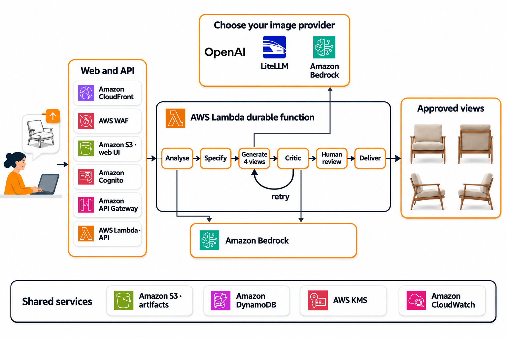
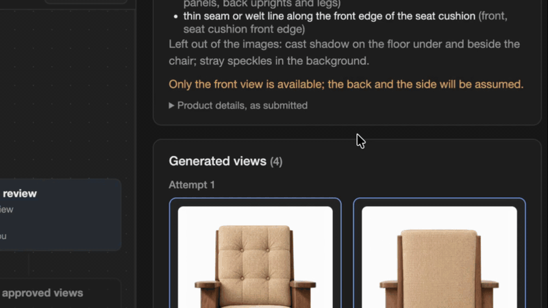

# Sketch to product views on AWS

Turn a product design sketch into four photoreal studio views (front, back and both sides), with
an AI critic that checks each view and retries the ones that fail, and a human approval step
before delivery. Built on AWS Lambda durable functions, Amazon Bedrock and Terraform, with a web
UI and a pluggable model registry.

It works for any sketched physical object with a front, a back and sides: furniture, lamps,
bottles, devices, toys, footwear, bags, garments. One to five images go in: sketches or photos
of the product and, optionally, a sample of its material (fabric, leather, wood, metal, plastic,
paint finish), untagged. Optional product details go with them, as plain text or JSON
(`Lounge chair, solid walnut frame, cream wool seat, 78 cm wide, 75 cm tall`, or a spreadsheet
row). The analyser decides what each image is, names the object and its parts, and those drive
the prompts and the critic. Failed views are regenerated with the critic's issues until they
pass or the attempt budget runs out. A human then approves the views or asks for changes. **The pipeline ends when a human approves the
views.**

The sample contains an AWS Lambda durable function that runs the pipeline, its HTTP API, a web
UI and Terraform. Read [LEARNINGS.md](LEARNINGS.md) first.





## How it works

```text
validate ─► analyse ─► complete_spec ─► prompt ─► generate front ─► back ─► left ∥ right
                                          ▲                                        │
                                          │                                        ▼
                                          └──── retry failed views ◄──────── evaluate_2d
                                                and their dependants               │
                                                                                   ▼
                                                            human_review (approve, or regenerate
                                                            with notes) ─► deliver
```

| Stage | Code | What it does |
| --- | --- | --- |
| validate | [`pipeline/src/stages/validate.ts`](pipeline/src/stages/validate.ts), `validatePackage()` in [`contracts/src/inputs.ts`](contracts/src/inputs.ts) | Accepts 1 to 5 images, untagged; checks every stored file against the model limits. |
| analyse | [`shared/src/analyse/sketch-analyser.ts`](shared/src/analyse/sketch-analyser.ts) | One model call on every image and the product details: what each image is (sketch, photo, material sample, unrelated), what the object is, views drawn, parts, details, marks to ignore. No sketch or photo of the product fails the run. |
| complete_spec | [`contracts/src/spec.ts`](contracts/src/spec.ts) | Pure code. Product type, material, colour and dimensions, each `supplied` (metadata) or `observed` (images); dimensions only supplied. Nothing is defaulted. |
| prompt | [`shared/src/generate/prompt.ts`](shared/src/generate/prompt.ts) | A deterministic, object-neutral template: which source decides what, generic material guidance, per-view camera, must-match list, corrections, design-team requests. |
| generate_2d | [`shared/src/generate/views.ts`](shared/src/generate/views.ts), [`openai-image.ts`](shared/src/generate/openai-image.ts) | One image-edit call per view. Front from the sketches and photos + the material sample (as the analyser picked them), back from the front render, profiles from the front and back renders. |
| evaluate_2d | [`shared/src/qc/judge/`](shared/src/qc/judge) | One Amazon Bedrock (Converse API) call compares the view with the first sketch (else the first photo) and the material sample, aspect by aspect and part by part. A view that would fail is read a second time; code fails it only on what both readings confirm ([`verdict.ts`](shared/src/qc/judge/verdict.ts)). |
| retry | `twoDLoop` in [`pipeline/src/handler.ts`](pipeline/src/handler.ts) | Up to `ATTEMPT_BUDGET` (default 2) attempts. A failed front remakes all four views, a failed back remakes back and profiles, a failed profile remakes itself. When the budget runs out, the best attempt goes to review flagged as rejected. |
| human_review | `review()` in the handler | `waitForCallback`. *Regenerate with notes* routes the notes to the views they concern and remakes those views (up to 3 regenerations). |
| deliver | `deliver()` in the handler | Copies the approved views under `delivery/`. The run ends here. |

Design notes can also be given at submit time (`notes`); they shape the first generation.

## Models

Every model is an entry of the registry
([`shared/src/registry/models/`](shared/src/registry/models), one YAML file each). These ship;
the defaults are in bold:

| Role | Registry id | Model | Provider |
| --- | --- | --- | --- |
| Image | **`gpt-image-2.6-sunburst-openai`** | GPT Image 2.6 Sunburst | OpenAI API |
| Image | `gpt-image-2.6-flare-openai` | GPT Image 2.6 Flare (faster) | OpenAI API |
| Image | `gpt-image-sunburst-openai`, `gpt-image-flare-openai` | GPT Image 2.5 Sunburst, Flare | OpenAI API |
| Image | `gpt-image-sunburst`, `gpt-image-flare` | GPT Image 2.5 through a LiteLLM gateway | LiteLLM (an OpenAI-compatible proxy) |
| Analyser | **`analyser-sonnet-bedrock`** | Claude Sonnet 5.5 | Amazon Bedrock |
| Analyser | `analyser-luna-bedrock`, `analyser-luna-openai`, `analyser-luna-litellm` | GPT-5.6 Luna | Bedrock, OpenAI API, LiteLLM |
| Critic | **`critic-sonnet`** | Claude Sonnet 4.6 | Amazon Bedrock |
| Critic | `critic-nova-pro` | Amazon Nova Pro | Amazon Bedrock |

**To change a model:**

- **For one run:** pick the image model, and its size, quality, complexity and attempts, on the
  web UI's start form.
- **For a deployment:** set `image_model`, `analyser_model` or `evaluation_model` to a registry
  id in your tfvars file, then `make deploy`.
- **A model that is not listed:** add a YAML entry; see
  [Adapting it to your product and your image model](#adapting-it-to-your-product-and-your-image-model).

## Deploy to AWS

### Prerequisites

- Node.js 24 (the Lambda runtime is `nodejs24.x`) and npm.
- Terraform 1.9 or later, AWS CLI v2, Bash and make (Linux or macOS; on Windows, use WSL 2).
- AWS credentials for the target account, Region **us-east-1**.
- Amazon Bedrock model access for the analyser and critic models. Run `npm run models:check`
  to confirm what your credentials can call.
- An OpenAI API key stored in AWS Secrets Manager (the bare key, or JSON `{"apiKey": "..."}`),
  created outside Terraform so the key never enters the state. Without echoing or logging it:

  ```sh
  read -rs OPENAI_KEY; umask 077; f=$(mktemp); printf %s "$OPENAI_KEY" > "$f"; unset OPENAI_KEY
  aws secretsmanager create-secret --name s2pv/openai-api-key \
    --secret-string "file://$f" --query ARN --output text
  rm -f "$f"
  ```
- An S3 bucket for the Terraform state.

### Steps

```sh
make install
make config CONFIG=dev     # creates infra/envs/dev/dev.tfvars and backend/dev.s3.tfbackend
# edit them: openai_api_key_secret_arn in dev.tfvars, the state bucket in dev.s3.tfbackend
# (litellm-gateway.example.tfvars is the variant for an image model behind a LiteLLM gateway)

make deploy CONFIG=dev     # bundle, plan, confirm, apply, publish the web UI
make user CONFIG=dev EMAIL=you@example.com
```

Then open the `web_url` output and sign in with the temporary password Cognito e-mails you.
`make help` lists the other targets: `check` (tests, typecheck, web build), `plan`, `models`
(which registry models your credentials can call) and `destroy`. Credentials come from your environment
(`AWS_PROFILE`); the Region defaults to us-east-1. Details and outputs:
[infra/README.md](infra/README.md).

### Using the web UI

- **New run.** Drop 1 to 5 images (sketches, photos of the product, a material sample), add
  product details and design notes if you have them, pick the image model and the generation
  settings (the form shows how many image calls the run can make), and submit.
- **Follow the run.** The canvas shows the stages; the generate card shows each view of the
  current attempt as it is made. Click a stage to see its events, inputs, outputs and the model
  settings it used in the side panel; click the prompt to read the prompt of each view.
- **Review.** When the views are ready the run waits for you: approve them, or describe what to
  change and the pipeline remakes the views your description concerns (up to 3 times). Turn on
  *Notify me* to get a browser notification when a run needs you.
- **Delivery.** Approved views are copied under `delivery/` in the artifacts bucket and can be
  downloaded from the run page.

### Configuration

A run can choose its image model and that model's settings (size, quality, attempts, and any
other parameter its registry entry declares) on the start form; the API accepts only the values
the entry lists. Deployment defaults are Terraform variables in your tfvars file
([`infra/envs/dev/variables.tf`](infra/envs/dev/variables.tf)); the main ones:

| Variable | Default | Effect |
| --- | --- | --- |
| `image_model`, `analyser_model`, `evaluation_model` | registry defaults | Models, by registry id. |
| `image_size`, `image_quality` | the image model's registry defaults | Default view size and quality. |
| `attempt_budget` | `2` | Generate-and-evaluate attempts before review. |
| `review_timeout_days` | `7` | How long a run waits for review before it fails. |
| `openai_api_key_secret_arn`, `litellm_base_url`, `litellm_api_key_secret_arn` | empty | Provider keys (Secrets Manager ARNs) and gateway URL; set the ones your models need. |
| `web_domain_name`, `web_acm_certificate_arn` | empty | Custom domain for the web UI; needed for a TLS 1.2 minimum. |
| `guardrail_enabled`, `cognito_threat_protection` | `true`, `ENFORCED` | Security controls ([Security](#security)). |

### API

The HTTP API (Amazon API Gateway, JWT authorizer on Amazon Cognito) is served at `/api/*` on the
web UI's CloudFront distribution, behind the same AWS WAF web ACL; the web UI calls it on its own
origin (output `api_url`). The `execute-api` endpoint refuses requests that did not come through
CloudFront. Six routes ([`api/src/handler.ts`](api/src/handler.ts)):

| Route | Purpose |
| --- | --- |
| `GET /api/models` | Image models a run can choose. |
| `POST /api/uploads/presign`, `POST /api/uploads/confirm` | Upload inputs to S3 with presigned URLs. |
| `POST /api/revisions` | Start a run (async durable invocation). |
| `GET /api/revisions/{id}` | Status, stage events, candidates, verdicts. |
| `POST /api/revisions/{id}/review` | Approve, or regenerate with notes. |

## Adapting it to your product and your image model

This sample is tuned for OpenAI's GPT Image models through `/v1/images/edits`: several reference
images per call (sketches and photos, material sample, front render), and the `size`, `quality` and
`complexity` parameters the start form offers.

- **The output you want.** The image prompt is one deterministic template in
  [`shared/src/generate/prompt.ts`](shared/src/generate/prompt.ts): staging (product alone,
  seamless white background), camera per view, which source decides what, material guidance.
  Change it there to get, for example, a lifestyle background, a different camera height or
  another number of views. The prompt is stored on every candidate, so runs stay comparable.
- **Another image model.** Add a YAML entry under
  [`shared/src/registry/models/`](shared/src/registry/models) with the model's own parameters
  and options (`params`, `apiFieldMap`); the start form and the API pick them up. A provider
  with a different API needs an adapter next to
  [`openai-image.ts`](shared/src/generate/openai-image.ts) and a case in
  [`dispatch.ts`](shared/src/generate/dispatch.ts). Check what the model accepts before you
  rely on the view chain: a model that takes a single reference image cannot use the material
  sample or make the back and the profiles from the front render, so the prompt and
  [`views.ts`](shared/src/generate/views.ts) must change with it. Re-tune the prompt wording too:
  each image model reads prompts differently.
- **Another analyser or critic.** Both are registry entries on Bedrock (Converse); a model
  without native structured output sets `structuredOutput: false` and gets the schema in the
  prompt.

## Cost and data

- **Image calls.** Each attempt makes up to 4 image calls, so the default budget means at most 8
  before review. Each regeneration remakes the views it concerns. OpenAI prices GPT Image 2.6
  by token and publishes no per-image price
  ([model page](https://developers.openai.com/api/docs/models/gpt-image-2.6-sunburst)); check
  your usage dashboard after one run.
- **Bedrock calls.** One analyser call per run (plus one per set of notes), and critic calls
  per view and attempt. See [Amazon Bedrock pricing](https://aws.amazon.com/bedrock/pricing/).
- **Guardrail.** Charged per text unit evaluated, by policy: the free text of a run is screened
  once or twice (a few kilobytes at most), and every guarded Bedrock call also evaluates its
  answer. See the Guardrails section of
  [Amazon Bedrock pricing](https://aws.amazon.com/bedrock/pricing/).
- **Infrastructure.** Mostly pay-per-use (Lambda, API Gateway, DynamoDB on-demand, S3,
  CloudFront). AWS WAF charges per web ACL and per rule each month, plus per request
  ([AWS WAF pricing](https://aws.amazon.com/waf/pricing/)); AWS KMS customer managed keys have a
  monthly charge even when idle. Cognito threat protection (`ENFORCED` by default) needs the Plus
  feature plan, billed per monthly active user
  ([Amazon Cognito pricing](https://aws.amazon.com/cognito/pricing/)); set
  `cognito_threat_protection = "OFF"` for the Essentials plan.
- **Where data goes.** Inputs and outputs are stored in your account in us-east-1. The Bedrock
  calls use US geographic inference profiles, which can route requests to us-east-1, us-east-2
  or us-west-2. The image calls go to `api.openai.com`, which can process them outside the US;
  OpenAI keeps abuse-monitoring logs for up to 30 days by default
  ([Your data](https://developers.openai.com/api/docs/guides/your-data)). Use test drawings you
  own, or get the design owner's approval before sending real designs.

## Layout

```text
contracts/   zod schemas and pure rules shared by every package (stages, spec, attributes, views)
shared/      model registry (YAML), analyser, prompt, image clients, critic, stores
pipeline/    the durable-function handler and its stages
api/         the HTTP API Lambda function (revisions, review callback, models, uploads)
cli/         local runner of the same handler, for development
web/         React + Vite web UI
site/        GitHub Pages demo page and video
infra/       Terraform: security, guardrail, storage, auth, pipeline, api, web
docs/        specification, evaluation, durable-pipeline design
```

`make check` runs the tests (with fake AWS credentials and no OpenAI key, so no test can reach a
paid model), the typecheck and the web build.

## Recommendations for production

This sample leaves these to the deployer:

- **TLS 1.2 minimum.** Set `web_domain_name` and `web_acm_certificate_arn`: with the default
  `*.cloudfront.net` certificate CloudFront also accepts TLS 1.0 and 1.1
  ([CloudFront docs](https://docs.aws.amazon.com/AmazonCloudFront/latest/DeveloperGuide/DownloadDistValuesGeneral.html)).
- **Code signing (accepted risk in this sample).** `deploy.sh` builds and deploys the Lambda
  bundles from the operator's machine, unsigned, so nothing stops an altered bundle from being
  deployed by someone with deploy rights. For production, deploy from a pipeline that signs the
  bundles with AWS Signer and attach a Lambda code signing configuration that rejects unsigned
  code ([code signing](https://docs.aws.amazon.com/lambda/latest/dg/configuration-codesigning.html)).
- **Scope Bedrock permissions.** The pipeline role may invoke any foundation model and inference
  profile (`infra/modules/pipeline`); narrow it to the configured models' ARNs.
- **Require MFA** in Cognito (`mfa_configuration` in `infra/modules/auth`; optional today)
  ([MFA](https://docs.aws.amazon.com/cognito/latest/developerguide/user-pool-settings-mfa.html)).
- **Logs and availability.** Set `log_retention_days` (default 365) to your compliance period;
  add S3 replication or CloudFront origin failover if availability needs them.
- **Concurrency.** `api_reserved_concurrency` (20) and `pipeline_reserved_concurrency` (10) cap
  concurrent model calls; size them to your load, or set `-1` on an account whose concurrency
  limit is too low to reserve them
  ([reserved concurrency](https://docs.aws.amazon.com/lambda/latest/dg/configuration-concurrency.html)).
- **CI.** Run the tests and a scan (ASH, Checkov) on every change, and automate updates of the
  pinned GitHub Actions and npm packages (Dependabot or similar).
- **Data residency.** Get the design owner's and the provider's sign-off before sending real
  designs to a third-party image model ([Cost and data](#cost-and-data)).

## Docs

| Document | What |
| --- | --- |
| [LEARNINGS.md](LEARNINGS.md) | What to know before building on this |
| [docs/spec/](docs/spec/README.md) | The 2D specification and the decisions behind it |
| [docs/architecture/durable-pipeline-design.md](docs/architecture/durable-pipeline-design.md) | Durable-function design |
| [docs/evaluation/](docs/evaluation/README.md) | How the critic works and how to evaluate it on your own runs |
| [infra/README.md](infra/README.md), [web/README.md](web/README.md) | Deployment and web UI |
| [AGENTS.md](AGENTS.md), [THIRD_PARTY.md](THIRD_PARTY.md) | Rules for coding agents; third-party terms |

## Clean up

Empty the artifacts, web and logs buckets (including object versions; the buckets are
versioned), then run `make destroy CONFIG=dev`.

Deleting the pipeline function can take up to an hour while Lambda stops in-flight durable
executions. KMS keys are scheduled for deletion after 7 days. Delete the OpenAI secret and the
state bucket yourself.

## Security

- Every API route needs a Cognito JWT. Self sign-up is off; MFA (TOTP) is optional.
- **Each user reaches only their own data, enforced by IAM.** Every revision and artifact key
  starts with the owner's Cognito `sub`. The API function's own role cannot read DynamoDB or S3:
  for each request it assumes a user-data role with the caller's `sub` as a session tag, and that
  role only allows keys under that `sub`, so a cross-user read is denied by IAM, not only by the
  code ([D-32](docs/spec/13-decisions.md); how to check it in
  [infra/README.md](infra/README.md#per-user-data-access)). The pipeline keeps a service role
  over all users' data, because it runs for days after the user has left; it builds every key
  from the run's owner and refuses inputs outside that owner's prefix.
- **The API is behind CloudFront and AWS WAF.** Browsers call `/api/*` on the web UI's
  distribution. CloudFront adds a secret header (generated by Terraform, kept in the API
  function's KMS-encrypted environment) that the function checks with a constant-time compare
  before any route runs; a direct call to the `execute-api` URL gets a 403, even with a valid
  token. The WAF web ACL runs the AWS managed Common and Known Bad Inputs rule sets, a rate limit
  per IP (2,000 requests per 5 minutes) and a tighter one on API writes (100 POSTs per 5
  minutes). One exception: the Common rule set's 8 KB body-size rule counts instead of blocking
  for `POST /api/revisions` and `/api/revisions/{id}/review`, whose product details (up to
  64 KB) and notes exceed it; it blocks everywhere else, and the API checks those sizes itself.
- **Cognito threat protection is enforced** (`cognito_threat_protection`): risky sign-ins must
  pass the user's TOTP challenge (high risk blocks users without MFA), and a password found in a
  public breach is blocked at sign-in or password change. It needs the Plus feature plan, which
  has a cost ([Amazon Cognito pricing](https://aws.amazon.com/cognito/pricing/)). Cognito
  recommends a period in `AUDIT` first.
- Product data (artifacts bucket, DynamoDB table) and CloudWatch log groups are encrypted with
  customer managed KMS keys. The web bucket has its own key, which only this CloudFront
  distribution can use to read; the access-log bucket uses SSE-S3, which S3 server access logs
  require. CloudFront access logs use logging v2, so no bucket has ACLs enabled.
- CloudFront enforces TLS 1.2 or later only with a custom domain (`web_domain_name` and
  `web_acm_certificate_arn`); with the default `*.cloudfront.net` certificate it also accepts
  TLS 1.0 and 1.1.
- Buckets block public access and require TLS. The web bucket is reachable only through
  CloudFront (Origin Access Control), behind AWS WAF.
- A run that fails outside the pipeline's own error handling (an unhandled error, an execution
  timeout, a stopped execution) leaves its submit event in the pipeline's dead-letter queue
  (output `pipeline_dlq_url`) for a redrive.
- Secrets stay in Secrets Manager; Lambda roles can read only the secrets you name.
- **Free text is sanitised.** Product details, file names, the product ID, design notes and
  review notes go through one function (`sanitizeText` in `contracts`) in the web form, the
  CLI, the API (before any check) and the pipeline: Unicode NFKC; control, zero-width, bidi and
  other invisible format characters removed; line endings and blank runs normalised. JSON
  product details keep their structure.
- **Free text is screened** by an Amazon Bedrock guardrail (`guardrail_enabled`, on by default):
  content filters (hate, insults, sexual, violence, misconduct) and prompt-attack detection.
  Every Bedrock call sends it with only the user's text marked as `guardContent`; text bound for
  the image model is screened with `ApplyGuardrail` first. A block stops the stage with the
  policy's name (never the text) on the rail; a blocked review note is refused by the API with a
  400 so the run continues. Text drawn inside an image reaches the models as pixels and is not
  screened: the prompts tell the analyser and the critic to treat it as data. Details in
  [docs/spec/13-decisions.md](docs/spec/13-decisions.md#security) (D-29).
- This is sample code. Review it against your own security and compliance requirements before
  production use. Treat model output as untrusted, and keep a human approval step.

To report a security issue, see
[AWS vulnerability reporting](https://aws.amazon.com/security/vulnerability-reporting/).

## License

This sample is licensed under the MIT-0 License; see [LICENSE](LICENSE). Third-party components
and terms are listed in [THIRD_PARTY.md](THIRD_PARTY.md). Contributions: [CONTRIBUTING.md](CONTRIBUTING.md).
